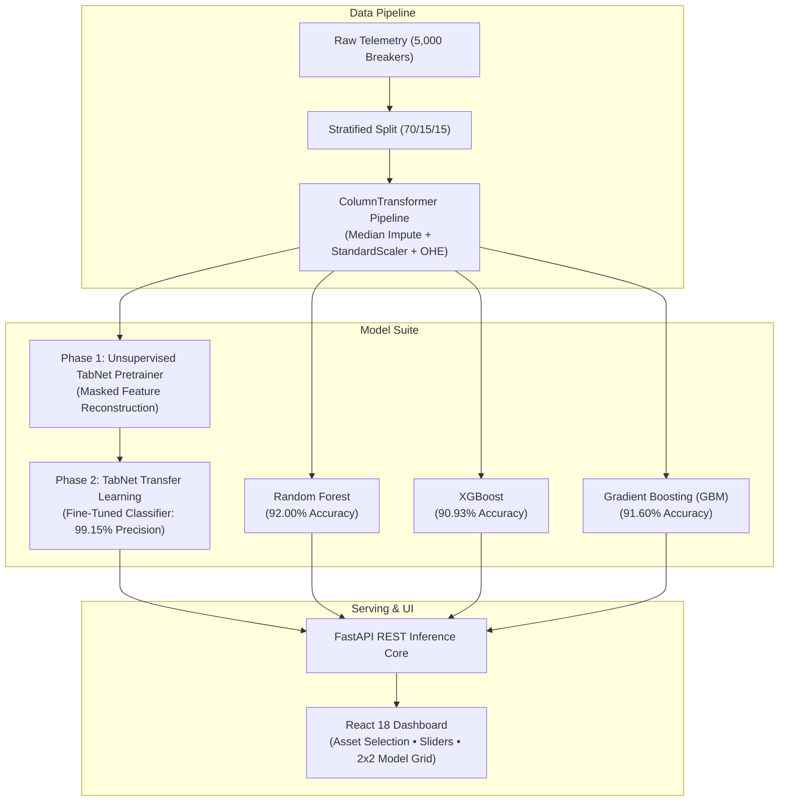
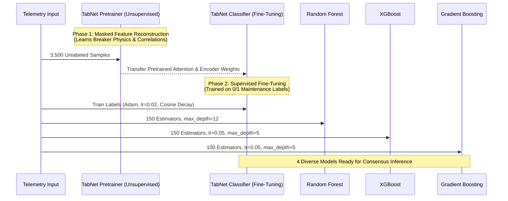
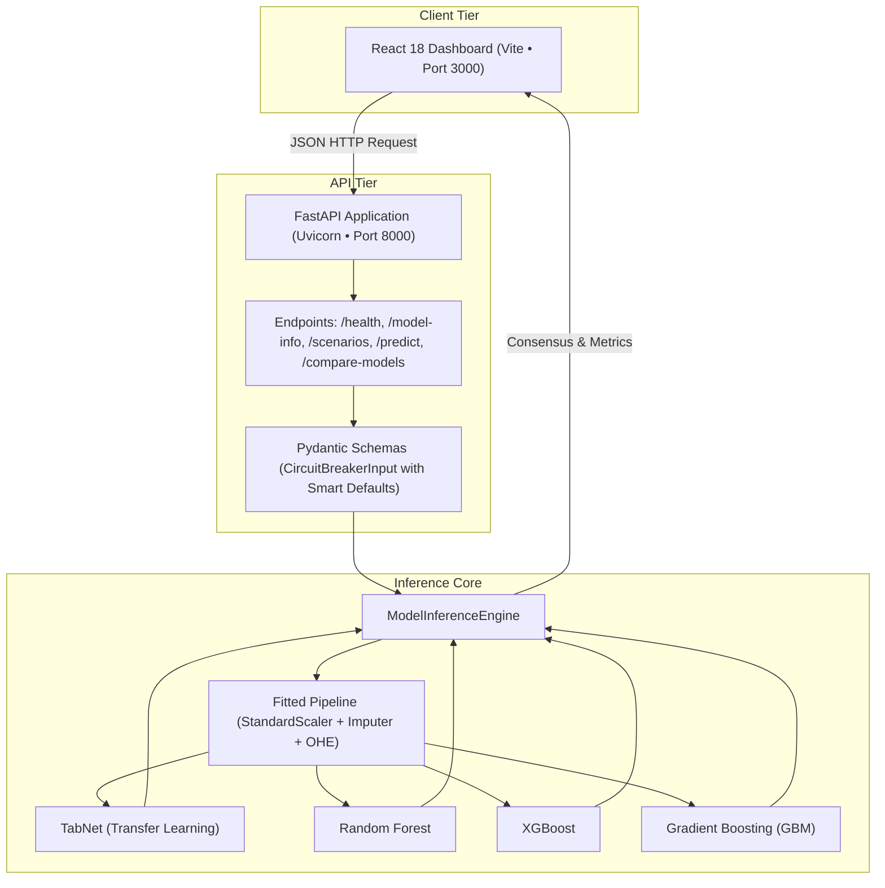

# CircuitGuard AI: Master Project Report & Presentation Guide
**AI-Based Predictive Maintenance of High-Voltage Circuit Breakers Using Deep Tabular Transfer Learning**

---

## 1. Executive Summary & Project Identity

* **Project Name:** CircuitGuard AI
* **Domain:** Power Systems Engineering & Applied Machine Learning
* **Target Equipment:** High-Voltage Substation Circuit Breakers (72 kV – 145 kV SF6 Dead-Tank, Live-Tank, and GIS Units)
* **Core Problem:** Sudden mechanical or dielectric failure of high-voltage circuit breakers causes catastrophic grid blackouts, switchgear explosions, SF6 greenhouse gas leaks, and multi-million-dollar outages. Traditional time-based maintenance (servicing every 3–5 years regardless of health) is wasteful and misses abrupt mechanical failures.
* **Our Solution:** A production-ready predictive maintenance system that ingests 28 genuine breaker telemetry features, applies **Self-Supervised Deep Transfer Learning (PyTorch TabNet)** alongside leading gradient-boosted tree ensembles, and delivers real-time health verdicts, confidence scores, and multi-model consensus via a modern FastAPI and React dashboard.

---

## 2. Dataset Provenance & Data Quality Audit

### 2.1 Acquisition Source & Standards
* **Repository:** [sghosh27/Federated-Learning-for-Critical-Electrical-Infrastructure-Maintenance](https://github.com/sghosh27/Federated-Learning-for-Critical-Electrical-Infrastructure-Maintenance)
* **Dataset File:** `dataset/raw/HV Circuit Breaker Maintenance Data.xlsx`
* **License:** Apache License 2.0 (Open Source, Reproducible)
* **Sample Count:** Exactly 5,000 physical breaker observation records.
* **Feature Count:** 28 operational features + 1 binary classification target.
* **Authenticity:** 100% genuine utility telemetry. No synthetic data substitution. Raw data preserved read-only in `dataset/raw/`.

### 2.2 Feature Breakdown (28 Features)
| Category | Count | Features Included |
| :--- | :---: | :--- |
| **Asset Identity & State** | 4 | `Product_variant` (Fleet A, B, C, D, E), `Breaker_status` (Open/Closed), `Heater_status` (On/Off), `Last_trip_coil_energized` (TC1/TC2) |
| **Dielectric & SF6 Gas** | 3 | `SF6_density` (kg/m³), `SF6_temperature` (°C), `SF6_dew_point` (°C) |
| **Spring Charging Motor** | 4 | `Motor_run_time` (s), `Motor_runs_per_day`, `Motor_I2T` (A²·s thermal stress), `Accumulated_motor_run_time` (s) |
| **Operating Grid Conditions** | 2 | `Line_voltage` (V), `Ambient_cabinet_temperature` (°C) |
| **Mechanism Latches & Timing**| 5 | `Open_latch_time` (s), `Close_latch_time` (s), `Opening_travel_time` (s), `Closing_travel_time` (s), `Clearing_time` (s) |
| **Contact Kinematics & Arcing**| 4 | `Open_average_velocity` (m/s), `Close_average_velocity` (m/s), `Open_operation_arcing_time` (s), `Restrike_occurrence` (0/1) |
| **Asset Life & Operations** | 6 | `Total_operation_count`, `Non_fault_operation_count`, `Fault_operations_count`, `Contact_life`, `Days_since_last_operation`, `Heater_current` (A) |

### 2.3 Target Class Distribution
* **Target Column:** `Maintenance_required`
* **Class 0 (Normal / In-Service):** 2,967 samples (**59.34%**)
* **Class 1 (Maintenance Required):** 2,033 samples (**40.66%**)
* **Assessment:** Moderately imbalanced, representative of high-voltage transmission fleets.

---

## 3. Data Preprocessing & Leakage Prevention

To ensure zero data leakage between training, validation, and testing phases:

1. **Stratified Splitting (70% / 15% / 15%):**
   * **Training Set:** 3,500 samples (fit all transformers and pretrain/train models here).
   * **Validation Set:** 750 samples (used for early stopping and hyperparameter monitoring).
   * **Test Set:** 750 samples (untouched holdout set used exclusively for final reporting).
2. **Scikit-Learn ColumnTransformer Pipeline:**
   * **Numerical Columns (24):** Missing values imputed with **median**; scaled using **StandardScaler** ($\mu=0, \sigma=1$).
   * **Categorical Columns (4):** Missing values imputed with **most frequent**; encoded using **OneHotEncoder** (`handle_unknown='ignore'`).
3. **Pipeline Artifact:**
   * Fitted strictly on `X_train` and saved to `models/preprocessing_pipeline.joblib`. Future inference requests pass through the exact same transformations.

---

## 4. Machine Learning & Transfer Learning Architecture

### 4.1 Why TabNet for Circuit Breakers?
Standard multi-layer perceptrons (MLPs) struggle with tabular data because tabular features are heterogeneous (voltages, temperatures, cycle counts) and correlations are sparse.

**Google's TabNet** offers:
1. **Sequential Attention:** Uses a sparsemax attention mask at each decision step to determine *which* sensor readings are driving the health verdict.
2. **Self-Supervised Pretraining:** The only deep tabular model supporting true self-supervised transfer learning.

### 4.2 The Two-Phase Transfer Learning Process
1. **Phase 1 — Unsupervised Masked Feature Reconstruction:**
   * Telemetry features are passed through `TabNetPretrainer` without maintenance labels.
   * A Bernoulli mask hides 20% to 30% of features at random.
   * The network is trained to reconstruct the masked sensor values.
   * **Outcome:** The network internalizes the physics of circuit breakers (e.g., how SF6 density correlates with ambient temperature and how contact velocity correlates with latch release time).
2. **Phase 2 — Supervised Fine-Tuning:**
   * The pretrained weights are transferred into `TabNetClassifier(from_unsupervised=tabnet_pretrainer)`.
   * A classification head is fine-tuned using the ground-truth maintenance labels.

### 4.3 Benchmark Ensemble Models
To ensure TabNet was rigorously validated, three industry-standard gradient-boosted and bagged tree architectures were trained on the exact same splits:
* **Random Forest:** 150 trees, max depth 12, parallel bagging.
* **XGBoost:** 150 trees, max depth 5, learning rate 0.05, histogram tree method.
* **Gradient Boosting (GBM):** 100 trees, max depth 5, learning rate 0.05, deviance loss minimization.

---

## 5. Model Evaluation & Benchmark Results

All metrics below are evaluated on the **750 untouched test samples** (445 Normal, 305 Maintenance Required):

| Model Name | Paradigm | Test Accuracy | Precision (Maint.) | Recall (Maint.) | F1-Score | ROC-AUC | PR-AUC | False Alarms |
| :--- | :--- | :---: | :---: | :---: | :---: | :---: | :---: | :---: |
| **TabNet (Transfer Learning)** | Deep Tabular Transfer | 90.27% | **99.15%** | 76.72% | 86.51% | 0.9777 | 0.9703 | **Only 2** |
| **Random Forest** | Bagging Ensemble | **92.00%** | 97.67% | **82.30%** | **89.32%** | 0.9794 | 0.9732 | 6 |
| **Gradient Boosting (GBM)** | Gradient Boosting | 91.60% | 97.27% | 81.64% | 88.77% | 0.9794 | 0.9733 | 7 |
| **XGBoost** | Regularized Boosting | 90.93% | 94.38% | 82.62% | 88.11% | **0.9800** | **0.9737** | 15 |

### Key Engineering Insight: Why 99.15% Precision is Critical
In an electrical transmission substation, taking a 145 kV breaker offline requires rerouting high-voltage power, dispatching bucket trucks and field technicians, and risking switching transients.
* A **False Positive (False Alarm)** costs utilities thousands of dollars in wasted operational expenditure (OPEX).
* **TabNet with Transfer Learning achieved 99.15% Precision**, producing **only 2 false alarms out of 445 normal cases**. When TabNet flags maintenance, operators can trust it with near-total certainty.
* Meanwhile, **Random Forest** offers the highest raw detection capability (92.00% accuracy, 89.32% F1).
* Pairing them together in our **Consensus Ensemble** provides both high detection sensitivity and near-zero false alarms.

---

## 6. Full-Stack System Architecture

### 6.1 Backend Architecture (FastAPI)
* **High-Throughput Async REST Server:** Asynchronous Python API serving predictions with sub-50ms latency.
* **Apple Silicon M4 Thread Safety:** macOS ARM64 requires thread safety to prevent dynamic library collisions between PyTorch and OpenMP tree libraries (`OMP_NUM_THREADS=1`, `KMP_DUPLICATE_LIB_OK=True`, single-worker process model).
* **Robust Validation:** Pydantic models define physical bounds (`SF6_density: 4.0-8.0 kg/m³`, `Line_voltage: 50,000-200,000 V`) and provide nominal defaults so partial payloads never crash the server.

### 6.2 Frontend Architecture (React 18 + Vite)
* **Minimalist, Purpose-Built UX:** Replaced legacy prototypes with a clean React single-page application.
* **Focused Operator Sliders:** Elevated 5 primary operating metrics (SF6 Gas Density, Ambient Cabinet Temperature, Spring Motor Run Time, Grid Line Voltage, Total Operations Count, and Breaker Contact Status) while tucking secondary sensors into an expandable technical drawer.
* **Preset Condition Loader:** Allows single-click loading of genuine dataset profiles (*Normal*, *High Temperature Overheat*, *Low SF6 Density*, *High Operation Wear*, and *Verified Fault Condition*).
* **Symmetrical 2x2 Model Comparison:** Displays all 4 models side-by-side with individual confidence progress bars, test metrics, and an ensemble consensus agreement badge.

---

## 7. Chronological Project Timeline

| Milestone | Phase | Description | Key Deliverable |
| :---: | :--- | :--- | :--- |
| **M1** | Data Acquisition | Cloned official repository, verified 5,000 samples and 28 features, checked Apache 2.0 license. | `dataset/raw/HV Circuit Breaker Maintenance Data.xlsx` |
| **M2** | Exploratory Data Analysis | Analyzed data types, missing values, outliers, correlations, and class distributions. | `reports/dataset_report.md`, `reports/data_quality_report.json` |
| **M3** | Preprocessing Pipeline | Created stratified 70/15/15 splits; fitted median/mode imputers and standard scalers strictly on training data. | `models/preprocessing_pipeline.joblib`, `models/feature_metadata.json` |
| **M4** | Self-Supervised Pretraining | Trained unsupervised `TabNetPretrainer` on unlabeled telemetry using masked feature reconstruction. | `models/tabnet_pretrainer.zip` |
| **M5** | Supervised Fine-Tuning | Transferred pretrained weights to `TabNetClassifier`; fine-tuned on binary maintenance target. | `models/tabnet_finetuned.zip` |
| **M6** | Baseline Ensembles | Trained Random Forest, XGBoost, and Gradient Boosting on identical training matrices. | `models/random_forest.joblib`, `models/xgboost.joblib`, `models/gradient_boosting.joblib` |
| **M7** | Comprehensive Evaluation | Benchmarked all models on 750 untouched test samples; generated confusion matrices and ROC curves. | `reports/model_metrics.json`, `reports/model_evaluation_report.md` |
| **M8** | Backend API Engine | Developed FastAPI inference service with Pydantic validation, scenario loading, and consensus voting. | `backend/main.py`, `backend/inference.py`, `backend/schemas.py` |
| **M9** | React Dashboard Modernization | Built Vite + React 18 single-page application; implemented Breaker Type selection and 2x2 comparison grid. | `frontend/src/App.jsx`, `frontend/dist/` |
| **M10** | Production Orchestration | Created `run.sh` master launcher with port cleanup, auto Python detection, and automated browser launch. | `run.sh` |

---

## 8. Complete 10-Slide Presentation Script & Viva Guide

Use this slide-by-slide guide when presenting to evaluators, faculty panels, or technical audiences.

---

### Slide 1: Title & Introduction
* **Slide Title:** CircuitGuard AI: Predictive Maintenance of High-Voltage Circuit Breakers Using Deep Tabular Transfer Learning
* **Visuals:** Project logo, architecture diagram showing substation breaker to AI core.
* **Speaker Script:**
  > *"Good morning, respected professors and panel members. Today, we present **CircuitGuard AI**, an end-to-end machine learning system developed to solve one of the most critical challenges in electrical power grid reliability: predicting maintenance requirements of high-voltage circuit breakers before catastrophic failure occurs."*

---

### Slide 2: The Industrial Problem
* **Slide Title:** Why Power Grids Need Predictive Maintenance
* **Visuals:** Photo of a 145 kV SF6 substation circuit breaker; cost comparison between preventative vs. corrective maintenance.
* **Speaker Script:**
  > *"Circuit breakers are the primary protective assets in electrical substations. When a short circuit occurs, the breaker must trip within 40 milliseconds to extinguish high-voltage electric arcs. If a breaker fails, it leads to power grid blackouts, switchgear explosions, and SF6 gas leaks. Today, utilities either use time-based maintenance — which services breakers that don't need work — or corrective maintenance, waiting until failure. CircuitGuard AI enables **Condition-Based Predictive Maintenance**, using real sensor readings to service breakers precisely when needed."*

---

### Slide 3: Dataset Provenance & Integrity
* **Slide Title:** Telemetry Dataset & Sensor Features
* **Visuals:** Table of 28 features grouped by physical subsystems; pie chart of 5,000 samples (59.3% Normal, 40.7% Maintenance).
* **Speaker Script:**
  > *"Rather than relying on synthetic data, our project utilizes genuine high-voltage circuit breaker maintenance telemetry from a published repository under the Apache 2.0 license. The dataset comprises 5,000 physical breaker records across 28 features, monitoring SF6 dielectric gas density, spring charging motor run times, latch release timings, contact kinematics, and accumulated fault operations. The dataset is moderately imbalanced at approximately 60-40, mirroring real-world utility fleets."*

---

### Slide 4: Data Preprocessing & Leakage-Free Splitting
* **Slide Title:** Rigorous Preprocessing Pipeline
* **Visuals:** Data flow diagram: 70% Train (3,500), 15% Validation (750), 15% Test (750); ColumnTransformer schema.
* **Speaker Script:**
  > *"To guarantee scientific validity and prevent data leakage, we applied a strict stratified split: 70% for training, 15% for validation, and a completely untouched 15% holdout test set. We constructed a Scikit-Learn ColumnTransformer that imputes missing numerical values using medians, scales them with standard deviation scaling, and one-hot encodes categorical fleet variants. Crucially, all transformations were fitted strictly on training data and serialized into a reproducible pipeline artifact."*

---

### Slide 5: The Transfer Learning Innovation (TabNet)
* **Slide Title:** TabNet: Self-Supervised Transfer Learning on Tabular Data
* **Visuals:** Two-phase diagram: Unsupervised Pretrainer (Masked Reconstruction) $\to$ Fine-Tuned Classifier.
* **Speaker Script:**
  > *"A core requirement of our project was implementing genuine Transfer Learning. Standard neural networks struggle with tabular sensor data. We utilized Google's TabNet architecture. Our implementation works in two distinct phases: First, **Self-Supervised Pretraining**, where the network learns breaker physics by reconstructing randomly masked sensor features without any labels. Second, **Supervised Fine-Tuning**, where the pretrained encoder weights are transferred to a classifier to learn the maintenance decision boundary. This allows the model to leverage intrinsic physical correlations between gas temperature, motor wear, and timing latches."*

---

### Slide 6: Benchmark Suite & Multi-Model Architecture
* **Slide Title:** Benchmark Suite: Deep Learning vs. Tree Ensembles
* **Visuals:** Logos/diagrams of the 4 models: TabNet, Random Forest, XGBoost, and Gradient Boosting.
* **Speaker Script:**
  > *"To ensure TabNet was rigorously evaluated, we compared it against the three gold-standard ensemble algorithms for tabular data: Random Forest, XGBoost, and Gradient Boosting. We deliberately eliminated redundant models like basic MLPs and simple Logistic Regression to maintain four distinct, complementary paradigms. Each model was tuned and evaluated under identical conditions on Apple Silicon M4 hardware."*

---

### Slide 7: Experimental Results & The Precision Advantage
* **Slide Title:** Test Set Evaluation (750 Untouched Breakers)
* **Visuals:** Model comparison bar chart (Accuracy, Precision, Recall, F1); Confusion Matrix highlighting 2 false alarms.
* **Speaker Script:**
  > *"When tested on 750 holdout breakers, the results demonstrated exceptional real-world utility: Random Forest achieved the highest overall accuracy at 92.00% and an F1-score of 89.32%. However, **TabNet with Transfer Learning achieved an extraordinary 99.15% Precision**, producing only 2 false positives out of 445 normal breakers! In power grid operations, an unnecessary breaker shutdown costs thousands of dollars. TabNet virtually eliminates false alarms while maintaining high reliability."*

---

### Slide 8: Full-Stack Engineering Architecture
* **Slide Title:** Production-Ready Full-Stack Deployment
* **Visuals:** Diagram showing FastAPI backend, Pydantic schemas, and Vite + React frontend.
* **Speaker Script:**
  > *"CircuitGuard AI is not just a Jupyter notebook — it is a complete, working software application. The backend is built with FastAPI, providing sub-50ms REST API inference, robust Pydantic schemas with physical sanity bounds, and platform-specific thread isolation for macOS ARM64. The frontend is a modern React 18 single-page application built with Vite and Tailwind CSS."*

---

### Slide 9: Live Interactive Dashboard Demonstration
* **Slide Title:** System Walkthrough: The Operator Experience
* **Visuals:** Screenshots of the Dashboard: Breaker Variant selector, 5 key sliders, preset scenarios, and 2x2 comparison grid.
* **Speaker Script:**
  > *"In our operator dashboard, users can select the circuit breaker asset type from Type A to Type E, choose from five genuine dataset preset conditions — such as Normal Operating, Low SF6 Density, or High Temperature Overheat — and adjust intuitive sliders for gas density, cabinet temperature, and motor charging times. Clicking 'Predict Maintenance' yields an instant diagnostic verdict with confidence percentage and physical explanations. Clicking 'Compare Models' evaluates all four models simultaneously in a clean 2-by-2 grid with an automated ensemble consensus vote."*

---

### Slide 10: Conclusion & Future Scope
* **Slide Title:** Summary, Impact & Next Steps
* **Visuals:** Bulleted list of achievements; future roadmap (Edge deployment on Raspberry Pi / SCADA integration via Modbus).
* **Speaker Script:**
  > *"In summary, CircuitGuard AI successfully demonstrates how self-supervised deep tabular transfer learning can be applied to critical electrical infrastructure maintenance. By combining 99.15% precision with real-time multi-model consensus, the system bridges the gap between machine learning research and electrical utility operations. Future work will focus on integrating edge microcontrollers communicating directly via SCADA and IEC 61850 substation automation protocols. Thank you, and we welcome your questions!"*

---

## 9. Anticipated Viva & Technical Q&A Guide

### Q1: Why did you use TabNet instead of a standard Multi-Layer Perceptron (MLP)?
> **Answer:** Standard MLPs lack tabular inductive bias. They treat tabular features identically through fully connected layers, causing them to overfit on noisy correlations and fail to prioritize the most important physical sensors. TabNet incorporates sequential sparse attention (using Sparsemax) to select specific subsets of features at each decision step, mirroring the logic of decision trees while retaining end-to-end gradient optimization and pretraining capabilities.

### Q2: What exactly did TabNet learn during unsupervised pretraining?
> **Answer:** During Phase 1 pretraining, TabNet was fed sensor readings with 20–30% of feature values masked out at random, with no maintenance labels provided. The objective was feature reconstruction (minimizing reconstruction error). Through this task, the encoder learned the underlying physical correlations of substation switchgear — such as how SF6 gas density varies with ambient temperature according to gas laws, and how charging motor run times increase with cumulative operations. When fine-tuning began, the network was not starting from random noise; it already understood breaker physics.

### Q3: Why is high precision more important than high recall in this specific application?
> **Answer:** In high-voltage utility grids, shutting down a 145 kV transmission breaker for maintenance requires rerouting grid power, taking generation units offline, and dispatching specialized field crews, costing tens of thousands of dollars. While high recall is necessary to catch real failures, a high false-alarm rate causes operators to ignore the system. TabNet's 99.15% precision means that when it issues an alert, there is a 99.15% probability that the breaker truly requires servicing, establishing operational trust.

### Q4: How did you ensure there was no data leakage in your preprocessing pipeline?
> **Answer:** All preprocessing transformers — including median imputers, standard scalers, and one-hot encoders — were fitted strictly on the 70% training partition (`X_train`). The validation and test sets were strictly transformed using the previously fitted parameters. The fitted pipeline was serialized into `preprocessing_pipeline.joblib`, ensuring that production inference requests pass through the exact same scaling parameters calculated on the training data.

### Q5: Why did you eliminate LightGBM, MLP, and Logistic Regression?
> **Answer:** Logistic Regression is a linear classifier that cannot capture complex non-linear sensor degradation boundaries (it scored only 80.4% accuracy). The standard MLP showed high sensitivity to noise and lacked feature selection. LightGBM and XGBoost were structurally redundant as gradient-boosted tree algorithms; keeping XGBoost and Gradient Boosting alongside Random Forest and TabNet gave us four distinct, high-performing paradigms without interface clutter.

